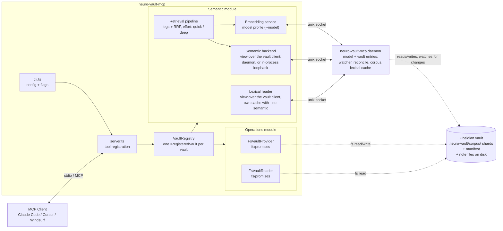

# Module Structure

How the server is split into pluggable modules and how they are wired together at startup.

## What it is

The codebase is organized into two modules under `src/modules/`:

- `semantic/` — search and similarity over the vault — 3 tools. Hosts hybrid `search_notes` (a semantic leg composed over the vault's own corpus, whose reads the shared daemon serves — see [`semantic-backend.md`](./semantic-backend.md) — plus a lexical leg via `src/lib/obsidian/lexical/`, whose cache lives in the same vault entry and which needs no embeddings — see [`lexical-search.md`](./lexical-search.md)), `get_similar_notes`, and `find_duplicates`
- `operations/` — direct vault operations — 10 tools, grouped as note body (`read_notes`, `create_note`, `edit_note`, `read_daily`), structured queries (`query_notes`), frontmatter properties (`set_property`, `remove_property`), tags (`list_tags`), and vault overview (`get_vault_overview`)

Inside `semantic/`, `search_notes` is layered so each step is one file: `tools/search-notes.ts` validates the request, pins the backend status and shapes the MCP payload; `retrieval-pipeline.ts` (`runRetrievalPipeline`) runs the semantic leg (`retrieval-policy.ts`) and the lexical leg, fuses them (`rank-fusion.ts`), and returns the candidates with one outcome record per leg; `search-observability.ts` (`deriveObservability`) is the pure step from those records to `truncated`, `semantic_status`, `query_stats` and the stderr warning. `effort-profiles.ts` holds the quick/deep pool numbers every layer reads. The retrieval eval harness (`eval/`) calls `runRetrievalPipeline` directly. See [`retrieval-policy.md`](./retrieval-policy.md#leg-outcome-records-and-observability) and [`rank-fusion.md`](./rank-fusion.md).

Each module exports `createXModule(config, deps) → { tools: ToolRegistration[], resources: ResourceRegistration[], warmup? }`. `src/server.ts` aggregates registrations from enabled modules and registers them with the underlying `McpServer`. Modules also expose `resources: ResourceRegistration[]`. Operations exposes one — `vault://overview`, a JSON snapshot of vault structure backed by the same `computeVaultOverview` function that powers the `get_vault_overview` tool. Semantic exposes no resources today. A module with no resources returns an empty array.

## Why it exists

Different users want different things. Some want semantic search and are fine with the background indexing it costs; some just want vault operations from their AI assistant; some want both. Splitting along this axis means:

- Users can disable the semantic module (`--no-semantic`) so no vault gets a semantic backend at all — no embedding-model load, no corpus reconcile, ever. `search_notes` stays registered and answers from its lexical leg alone, reporting `semantic_status: { state: "disabled" }`; only `get_similar_notes` and `find_duplicates`, which have no non-semantic leg, are unregistered. Operations tools are always registered — they are pure-object factories with no startup cost and no external runtime dependency.
- Each module is independently testable and reasonable in isolation.
- Adding a third module later (e.g. structural search) is a localized change — the server-level wiring is uniform.

## Boundaries

- A module's barrel (`src/modules/<name>/index.ts`) is its whole public surface: its tools, resources and optional `warmup`, plus what the composition root builds a session from — its slice of each vault's factories (`operationsVaultFactories`; the semantic vault clients or `lexicalOnlyVaultFactories`) and, for semantic, the session-wide constructors (shared services, embedding provider and queue, vault clients). Anything else is internal. `src/server.ts` imports a module only through its barrel, enforced by `no-restricted-imports` in `eslint.config.js` ([ADR-0022](../adr/0022-modules-hand-the-composition-root-their-factories.md)).
- Modules do not call each other. If two modules ever need to share data, that data should live in `src/lib/` and both consume it from there.
- Module-specific types live inside the module (`modules/<name>/types.ts`). `src/types.ts` only contains the shared `ServerConfig`.

## Wiring

```
parseConfig(argv) → ServerConfig
   │
   ▼
VaultRegistry.create(config, defaultVaultDeps(moduleSlices)) → VaultRegistry
   │  (one IRegisteredVault per --vault name:path; each vault's semantic
   │   backend decides its own readiness live, never throws)
   ▼
startNeuroVaultServer(config, deps)
   │
   ├─ if config.semantic.enabled  → createSemanticModule(registry, ...)  → registrations[]
   │  else                        → createLexicalOnlyTools(registry, ...) → [search_notes]
   ├─ createOperationsModule(registry, ...) → registrations[]   (always)
   │
   └─ register all → server.connect(transport) → warmup
```

Both module factories receive the whole `VaultRegistry` rather than individual vault configs. Tool handlers reach into the registry at call time — either targeting a named vault (`registry.require(name)`) or fanning out across all vaults (`registry.list()`). See [`vault-registry.md`](./vault-registry.md) for details.

Operations tools are always registered — their construction is a zero-cost pure-object factory with no warmup or initialization. Errors surface at tool-call time (a missing note, an unwritable path, an unconfigured Daily Notes plugin), never at startup.

## End-to-end shape



The `VaultRegistry` is built once at startup from the list of vaults declared via `--vault` flags (repeatable). Each entry bundles a reader, provider, wikilink graph, a `lexical` reader, and — when the semantic module is enabled server-wide — a `backend` over that vault's own corpus. A backend never fails startup: it decides its own readiness live, reported through `status()`, so a vault whose corpus is missing, incompatible, or fails to build simply reports `unavailable` with a reason rather than aborting the process. See [`vault-registry.md`](./vault-registry.md) and [`semantic-backend.md`](./semantic-backend.md).

Each vault's corpus is decoded once, in the shared daemon's vault entry for that directory, from the vault's own `.neuro-vault/corpus/<model_key>/` shards, and kept fresh by the entry's debounced watcher; a session reads it through its semantic backend, a view over the vault's one client ([ADR-0021](../adr/0021-vault-client.md)), and holds no vector of it. Under `--no-shared` the same vault entry runs inside the session, read through the daemon's own service handlers called in-process (see [`semantic-backend.md`](./semantic-backend.md) and [`vault-entry.md`](./vault-entry.md)). The lexical leg of `search_notes` reads note files from disk at call time behind an mtime cache that is a member of the same entry — one cache per vault directory, searched by every session through its `ILexicalReader`, the other view over the vault's client (`--no-semantic` alone keeps a cache in the session, [`lexical-search.md`](./lexical-search.md#who-holds-the-cache)). The vault's wikilink graph is a member of the same entry, served as `graph.*` and read through `createGraphReaderView` (`src/modules/semantic/graph/`), a third view over the client; until the cut-over of #172 lands, tools still read each session's own graph ([`wikilink-graph.md`](./wikilink-graph.md#wiring)). The operations module reads and writes the vault directory directly — `FsVaultReader` for batch reads (`read_notes`, `query_notes`) and for the `list_tags` / `list_properties` aggregate scans, and `FsVaultProvider` for every write to a single note (`create_note`, `edit_note`, `read_daily`, properties) — with no external process anywhere in the path (see [ADR-0009](../adr/0009-disk-direct-vault-operations.md) and [ADR-0016](../adr/0016-one-disk-module-owns-note-writes.md) for why one module, not two, owns those writes). The semantic module can be disabled via `--no-semantic`; operations tools are always registered.
